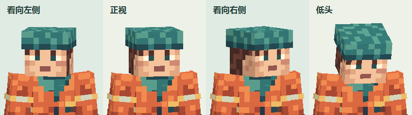

# SkinLiveOBS · 方块皮肤直播工具

把一张 Minecraft 皮肤 PNG 变成 OBS 或哔哩哔哩直播姬可以采集的方块人。角色能跟着鼠标转头、随麦克风音量张嘴，按空格跳跃，点鼠标左键挥动右手。右手可以拿原版木制工具。程序在 Windows 本机处理角色和输入，无需安装 Minecraft 或 VTube Studio。

**[下载 Windows 免安装版](https://github.com/sliuhaob/SkinLiveOBS/releases/latest)** · [下载示例皮肤 PNG](examples/lighthouse-keeper.png)


## 开始直播

1. 在 Releases 下载 Windows ZIP，完整解压，双击 `SkinLiveOBS.exe`。第一次打开会载入示例角色「灯塔值班员」。
2. 要换成自己的角色，将皮肤 PNG 拖进控制台，或点「打开皮肤 / 模型」。在「语音嘴型」里选择设备，勾选「启用麦克风」。底噪也让嘴巴张开时，把开口门限调高。
3. 选择全身或半身、绿幕或蓝幕，再点「打开直播窗口」。顶部的「桌面隐形」默认勾选，开启后输出窗口在主播桌面上透明，鼠标可以点到下面的应用。随时取消勾选即可看到输出窗口。
4. 在 OBS 场景里添加「窗口采集」，选择 **[SkinLiveOBS.exe] 方块皮肤 · OBS 输出**。捕获方式选 **Windows 图形捕获（WGC）**，在部分 OBS 版本中显示为「Windows 10（1903 及以上）」。开启客户区域，关闭捕获光标。直播姬可在场景里添加「窗口捕获」，选择同一窗口和相应的 Windows 捕获方式。
5. 给来源添加「色度键」，选与输出相同的绿幕或蓝幕。可从相似度 **250**、平滑度 **80**、溢色抑制 **60** 开始，按皮肤颜色微调。直播期间可以最小化控制台，保留独立输出窗口即可。来源列表里找不到窗口、隐形后出现黑屏或停帧时，取消「桌面隐形」，在采集软件中重新选中输出窗口。

B 站直播可沿用已有的 OBS 场景和推流设置。观众听到的声音由 OBS 的音频输入控制。[OBS 窗口采集说明](https://obsproject.com/kb/window-capture-sources) · [OBS 色度键说明](https://obsproject.com/kb/chroma-key-filter)

## 鼠标转头

在控制台「游戏动作 → 头部跟随」里选模式。默认「自动」在桌面上看向指针，当游戏锁定指针且鼠标仍在移动时，改用相对位移。若游戏频繁重置指针，手动选择「FPS 鼠标」即可。

| 模式 | 角色表现 |
| --- | --- |
| 桌面鼠标 | 看向指针在当前显示器上的位置，水平和垂直方向都能跟随。 |
| FPS 鼠标 | 向鼠标移动的方向转头，停下后逐渐回正。无需读取游戏视角。 |
| 关闭 | 头部回到正视位置。 |

转头与后台空格、左键分别控制。希望游戏中只跟随鼠标时，保留「头部跟随」，取消「在其他窗口也响应空格和鼠标左键」。预览与输出使用同一个姿势，嘴型贴在脸上，右手继续按 Java 原版握姿挥动。



## 更换右手物品

1. 在控制台点一次「获取原版贴图」。程序从 Mojang 官方样例仓库下载五张 16×16 PNG 并校验 SHA-256。同一 Windows 用户之后可以断网使用。
2. 在「右手物品」里选 **空手、木剑、木镐、木斧、木锹（木铲）或木锄**。直播中切换会直接反映在 OBS 输出里。五件工具都使用 Java 原版史蒂夫宽臂模型的第三人称右手握姿，随手臂挥动、随身体起跳。
3. 在离线电脑上，可把下表的五个原始 PNG 放进同一文件夹，点「离线导入」并选中该文件夹。工具只读取你选定的贴图文件夹和自己的物品缓存。文件可从固定版本的官方目录获取。[Mojang 原版贴图目录](https://github.com/Mojang/bedrock-samples/tree/15701fa9c13923f12662984c32c124327e40e3d3/resource_pack/textures/items)

| 物品 | 官方文件名 | 命令行 ID |
| --- | --- | --- |
| 木剑 | `wood_sword.png` | `minecraft:wooden_sword` |
| 木镐 | `wood_pickaxe.png` | `minecraft:wooden_pickaxe` |
| 木斧 | `wood_axe.png` | `minecraft:wooden_axe` |
| 木锹（木铲） | `wood_shovel.png` | `minecraft:wooden_shovel` |
| 木锄 | `wood_hoe.png` | `minecraft:wooden_hoe` |

## 皮肤和动作

- 读取标准 MC 展开图，支持 64×64、128×128 等方形皮肤，以及旧版 2:1 展开图。宽度须为 64 的整数倍，范围为 64 至 1024 像素。
- 自动识别宽臂和细臂贴图。袖口出现空边时可手动选「贴图布局」。模型采用经典宽臂身形，并保留帽子、衣服和袖口的透明外层。
- 动作以 Java 版普通平地跳跃和右手挥动为参考，在工具内根据按键计算。装备物品后，待机右臂向前抬起，左键会带动手中物品走完六个游戏刻的挥动。按住空格会在落地后继续跳。药水、击退和地形碰撞等游戏状态不参与计算。
- 麦克风默认关闭，启用后仅在内存中计算音量。自动和 FPS 模式使用 Windows 提供的相对鼠标位移。控制台会记住跟随模式、桌面隐形开关、设备和上次打开的皮肤，设置位于当前用户的 `%LOCALAPPDATA%\SkinLiveOBS`。

## 导出 Live2D

打开皮肤、选好右手物品后点「导出 Live2D」，选择保存位置。模型会保留当前握姿和物品，整套文件夹拷到另一台电脑也能显示这件物品。文件夹包含 `.moc3` 模型、`.model3.json`、纹理图集、显示参数和两段动作。v1.0 的空手模型和 v1.1.0 的持物模型均可打开。要更新已导出模型的握姿，在新版控制台打开原有的 `Avatar.model3.json`，再点「导出 Live2D」生成新副本。OBS 直播可直接采集新版输出窗口。

鼠标转头由 SkinLiveOBS 在直播时驱动，重新打开旧模型也能跟随。独立导出的 Live2D 模型提供嘴型、跳跃和挥动三个参数。

也可以在 PowerShell 中转换，输出目录须是一个新目录。

```powershell
.\SkinLiveOBS.exe --convert ".\examples\lighthouse-keeper.png" ".\my-model" auto
```

手臂布局可选 `auto`、`wide` 或 `slim`。默认导出空手模型。准备好原版贴图后，可在布局后追加物品 ID。例如，下面的命令会导出手持木锹的模型。

```powershell
.\SkinLiveOBS.exe --convert ".\examples\lighthouse-keeper.png" ".\shovel-model" auto minecraft:wooden_shovel
```

## 从源码编译

在 Windows 10 或 11 上使用 .NET Framework 4.x 桌面组件和系统 C# 编译器。仓库已包含模型模板，在仓库根目录运行以下命令即可生成 `SkinLiveOBS.exe`。

```powershell
.\source\build.cmd
```

要从某个 Git 提交或标签制作包含程序、示例和对应源代码的 ZIP，可用 Windows PowerShell 运行打包脚本。压缩包写入 `dist`。

```powershell
.\scripts\package.ps1 -Ref v1.2.0 -Version 1.2.0
```

修改模型结构时，可按制作说明重新生成模板。离线建模步骤使用 PSD2Live 的 umamo 编码器，常规编译和运行直接使用随包模板。[模板制作说明](source/author/模板制作说明.txt) · [PSD2Live 上游](https://github.com/tsunehimatoi/psd2live/tree/4115821026419258e4a44a782a786c013f59ee5f/umamo)

## 许可

程序源码和构建脚本采用 **GPL-3.0-only**。项目制作的空手和持物模型模板、图标、示例皮肤「灯塔值班员」及其图集和预览采用 **MIT** 许可。导出的模型文件夹随附模板许可，用户皮肤沿用各自授权。[程序许可](LICENSE) · [美术和模板许可](ASSET-LICENSE.txt)

五张原版物品贴图来自 Mojang 的 `bedrock-samples`，权利属于 Mojang。开源仓库和发行 ZIP 提供获取这些贴图的功能。导出持物模型时，所选物品的像素会写入图集，分享这类图集须遵守 Mojang 的条款。[Mojang 素材许可](https://github.com/Mojang/bedrock-samples/blob/15701fa9c13923f12662984c32c124327e40e3d3/LICENSE.md) · [Minecraft 使用指南](https://www.minecraft.net/en-us/usage-guidelines)
