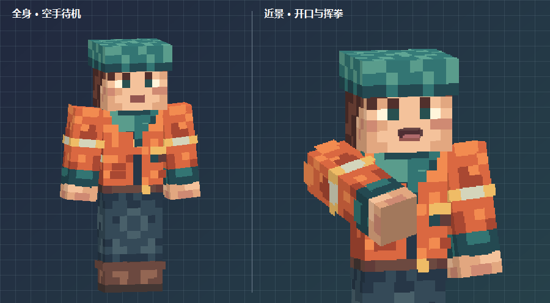

# SkinLiveOBS · 方块皮肤直播工具

把一张 Minecraft 皮肤 PNG 变成空手方块人，在 Windows 上用 OBS 采集。说话时角色随麦克风音量张嘴，空格跳跃，鼠标左键挥拳。角色和输入都在本机处理，可以离线使用，无需安装 Minecraft、模组或 VTube Studio。

**[下载 Windows 免安装版](https://github.com/sliuhaob/SkinLiveOBS/releases/latest)** · [下载示例皮肤 PNG](examples/lighthouse-keeper.png)



## 开始直播

1. 在 Releases 下载 Windows ZIP，完整解压，双击 `SkinLiveOBS.exe`。第一次打开会载入示例角色「灯塔值班员」。
2. 要换成自己的角色，将皮肤 PNG 拖进控制台，或点「打开皮肤 / 模型」。在「语音嘴型」里选择设备，勾选「启用麦克风」。底噪也让嘴巴张开时，把开口门限调高。
3. 选择全身或半身、绿幕或蓝幕，再点「打开直播窗口」。勾选「在其他窗口也响应空格和鼠标左键」，切换到其他应用后也能触发动作。
4. 在 OBS 场景里添加「窗口采集」，选择 **方块皮肤 · OBS 输出**。给来源添加「色度键」滤镜，选与直播窗口一致的颜色，然后把来源放在游戏画面上方。直播时保持输出窗口打开且未最小化。

B 站直播可沿用已有的 OBS 场景和推流设置。观众听到的声音由 OBS 的音频输入控制。[OBS 窗口采集说明](https://obsproject.com/kb/window-capture-sources) · [OBS 色度键说明](https://obsproject.com/kb/chroma-key-filter)

## 皮肤和动作

- 读取标准 MC 展开图，支持 64×64、128×128 等方形皮肤，以及旧版 2:1 展开图。宽度须为 64 的整数倍，范围为 64 至 1024 像素。
- 自动识别宽臂和细臂贴图。袖口出现空边时可手动选「贴图布局」。模型采用经典宽臂身形，并保留帽子、衣服和袖口的透明外层。
- 动作以 Java 版默认空手右拳和普通平地跳跃为参考，在工具内根据按键计算。按住空格会在落地后继续跳。药水、击退和地形碰撞等游戏状态不参与计算。
- 麦克风默认关闭，启用后仅在内存中计算音量。门限、设备选择和上次打开的皮肤路径保存在当前 Windows 用户的 `%LOCALAPPDATA%\SkinLiveOBS`。

## 导出 Live2D

打开皮肤后点「导出 Live2D」，选择保存位置。生成的文件夹包含 `.moc3` 模型、`.model3.json`、纹理图集、显示参数和两段动作。可以在控制台重新打开本工具导出的 `Avatar.model3.json`。OBS 直播可以直接使用工具的输出窗口。

也可以在 PowerShell 中转换，输出目录须是一个新目录。

```powershell
.\SkinLiveOBS.exe --convert ".\examples\lighthouse-keeper.png" ".\my-model" auto
```

最后一项可选 `auto`、`wide` 或 `slim`，用于指定输入贴图的手臂布局。

## 从源码编译

在 Windows 10 或 11 上使用 .NET Framework 4.x 桌面组件和系统 C# 编译器。仓库已包含模型模板，在仓库根目录运行以下命令即可生成 `SkinLiveOBS.exe`。

```powershell
.\source\build.cmd
```

要从某个 Git 提交或标签制作包含程序、示例和对应源代码的 ZIP，可用 Windows PowerShell 运行打包脚本。压缩包写入 `dist`。

```powershell
.\scripts\package.ps1 -Ref v1.0.0 -Version 1.0.0
```

修改模型结构时，可按制作说明重新生成模板。离线建模步骤使用 PSD2Live 的 umamo 编码器，常规编译和运行直接使用随包模板。[模板制作说明](source/author/模板制作说明.txt) · [PSD2Live 上游](https://github.com/tsunehimatoi/psd2live/tree/4115821026419258e4a44a782a786c013f59ee5f/umamo)

## 许可

程序源码和构建脚本采用 **GPL-3.0-only**。项目制作的空手模型模板、图标、示例皮肤「灯塔值班员」及其图集和预览采用 **MIT** 许可。工具会把模板的许可声明放进导出的模型文件夹。分享自己换皮后的模型时，请一并保留这份声明，并按所用皮肤的授权分发。[程序许可](LICENSE) · [美术和模板许可](ASSET-LICENSE.txt)
